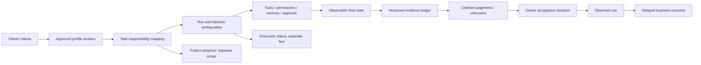

# Native evaluation: local implementation and acceptance

Status: local implementation authorized; deployment and release remain separately gated.

## Spec and outcome

An owner creates an agent, defines or adjusts success criteria, runs work, inspects evidence, and decides whether to accept the result. Reuse the operating-profile approval lifecycle, issue responsibility intervals, typed evaluator ledger, task Result review and Performance drilldown. Preserve task execution, verified criteria, owner acceptance, project progress and delayed business outcomes as separate facts.

The larger native-evaluation proposal remains the product roadmap. This iteration completes a usable local vertical slice, with honest pending states for unavailable evidence and human calibration. It does not claim production adoption or calibrated model judgment.

## Primary research and limits

[Anthropic](https://www.anthropic.com/research/demystifying-evals-for-ai-agents) separates tasks, repeated trials, graders, traces and environmental outcomes. Combine deterministic checks with calibrated model and genuine human judgment. Execution claims do not establish outcomes; isolated trials and regression suites complement production observation.

[OpenAI](https://developers.openai.com/cookbook/examples/partners/harness_aware_plugin_evals/harness_aware_plugin_evals) separates direct tool, standalone loop, SDK product harness and actual client checks. Its five-case grader checks tool behavior, not final-answer correctness. Recorded results are not fresh trials. SDK results are not desktop-client acceptance. The separate production benchmark is not reproduced by that notebook.

Our deterministic local worker validates AgentDash orchestration, API authority, durable memory and observable artifacts. It is not a language-model benchmark. Browser tests exercise the actual AgentDash client. Agent reviewers are never labeled human reviewers.

## UX and architecture

Use the existing four-step brief flow and the same editor for later profile revisions. Replace performance JSON with guided criteria, stable IDs, selectable evidence checks and explicit review expectations. Work-family suggestions (software, knowledge, support, other) are editable drafts, not imposed rubrics. Harness evidence remains a separately bound record, not an installed grader. Display unsupported predicates and absent measurement as unknown. Preserve advanced loaded fields and approval/application separation.

Expose the existing task-to-responsibility mapping in task Reviews. Show the active profile revision, criteria, mapping history and links to Profile and Performance. Server authority governs mapping; no client inference grants access. Explain that task completion and run success do not establish acceptance. Result Accept remains a revision-bound owner decision; criterion attestations remain named-person decisions. Project status is progress context and linked goal readings are business context, not causal credit.

Persistent agents retain versioned profiles, runtime sessions and memory. One-off work uses task/run identity and the same evidence contract; no permanent-agent score is required for an ephemeral helper. This iteration does not introduce a new agent lifecycle enum. Clean versus warm memory trials must be labeled. Missing and never-started work stay in the owed population. Expected approval/signoff is distinct from avoidable correction. Human minutes and actual business outcomes stay unavailable unless observed.

Reuse existing profile revisions, configuration revisions, responsibility mappings, ledger ingest, access filtering, obligations, cards, named attestations, document revisions, work products, approvals and run logs. No external evaluator, connector, paid API or new dependency is needed. Future model-grader backends must integrate through versioned, provenance-bound receipts with calibration, abstention and disagreement review. Keep external traces separate from authority to accept.

A task can finish execution while acceptance is pending. A blocked task can show a correct permission refusal. A project can progress while its business outcome is still unobserved. Team output requires its dependent deliverables' acceptance, not a sum of agent completion claims.

## Global Constraints

- Work only in this isolated evaluation branch; preserve staged #1122 and unrelated checkouts.
- No deployment, merge, release, spending, customer access, destructive migration or breaking API change.
- No new dependencies or database migration. Existing API additions must be backward compatible and tenant/visibility checked before projection.
- Agent claims, exit status, fabricated tool frames, grader names and missing evidence cannot establish acceptance.
- A legitimate approval block is neither completion nor a platform failure.
- Human calibration and owner acceptance remain pending without actual human evidence. Automated board fixture clicks are simulated owner actions, not human labels.
- Keep advanced profile data, criterion identity and revision-bound acceptance intact. Do not weaken a rubric after a regression fails.
- Test instances are loopback-only, disposable, credential-free and disconnected from external channels. Deterministic worker calls real local APIs; no provider call.
- Public source/docs contain no personal paths, credentials, customer details or private handoff records.

## Task 1: Guided owner setup and task binding

Implement a typed responsibility performance editor in the existing ProfileDraftEditor, shared by unbound creation and bound profile editing. Include editable criterion text, stable IDs, proof type (known recorded fact, named human, goal metric, unmeasurable), work-family suggestions, coverage, expected human steps and advanced preservation. Suggestions are preview text until a person explicitly adds them; adding a suggestion records its template source and never confirms unrelated fields or sets thresholds. A deliberate criterion edit can confirm only that changed leaf. Never auto-attest. Invalid edits must block save rather than silently drop input. Preserve unknown existing predicate values with an honest limitation.

Add a task Reviews section using existing issueResponsibilityApi and active profile. Support unmapped/no-agent/no-active-profile/forbidden/stale states; map to an active responsibility without copying it into task DoD. Add server-computed mapping authority only if needed, using the existing authority function and additive response fields. Distinguish the recorded mapping revision from the current active revision; same-key remapping may retain its older revision. Display criteria and revision with navigation to Profile/Performance and explanations separating execution, acceptance, project progress and outcomes. Ensure changing criteria uses draft/propose/approval/apply.

Test meaningful editor behavior, identity/advanced-field retention, invalid values, mapping authority/tenancy and UI mapping/refusal. Inspect source and tests before edits. Test first, then implement. Report changed files, commands/results, limitations and no external effects. Do not commit/push. Do not spawn agents.

## Task 2: Real isolated execution and outcome evidence

### Native verified-output slice

The trust audit found that legacy harness labels, agent verdicts, structured CI/PR handoffs, generic status/DoD facts and goal readings do not independently establish final output correctness. Keep these visible as their specific observations, but do not let them grant verified automated output acceptance. Permission approvals do not imply task-result acceptance.

Add one optional deterministic native proof mechanism: an owner-declared exact expected issue-document body, represented by document key and SHA-256. Use the existing record-check envelope with a documented `document.sha256:<encoded-key>:<digest>` predicate, so old request shapes remain valid. Offer readable document-key/expected-text fields; preserve saved digests and criterion IDs. Reuse the existing browser-safe SHA-256 implementation rather than a new dependency. Selecting a proof grants no acceptance.

Ingest immutable native document revisions through the existing ledger. Hash persisted body bytes on the server, bind company/issue/document key/revision/author/run and event time, and store digests rather than document text. Follow existing issue visibility/access-class rules before aggregation. The pure agent scorer compares the owner-approved predicate to the applicable observed revision at its pinned cut/as-of. Missing, stale, malformed or unbound evidence remains unknown; a different verified digest fails. Later revisions, deletion, replacement or scope changes invalidate current acceptance until checked again. Reconcile prior document identities against current links and validate authoritative current heads before exposing current positive acceptance, including ingest lag and delete-before-audit crash windows. A historical snapshot is labeled pinned and is never relabeled current; current validation is separately identified without rewriting the stored hash. Fence document identity plus revision, not revision number alone. Historical cuts remain reproducible. Use canonical percent-encoded keys and exact UTF-8 hashing without implicit whitespace or Unicode normalization. Only this verified native path grants positive automated output acceptance in this slice; all other mandatory criteria still need qualifying evidence and cannot be masked by one pass. Human-only and use checks remain separate. This is an exact-output option for suitable tasks, not a generic measure of writing quality, support resolution or business impact. Those can remain named-human checks or pending external grader integrations.

Add database/source, pure scoring and actual runtime tests proving provenance, isolation, revision changes, two mandatory checks, false completion, absent output and unsupported legacy receipt behavior. The fixed rubric uses this production check, not a test-only classifier. Bump event/formula versions additively; preserve old snapshot provenance/mismatch behavior. No database migration.

Add an isolated deterministic runtime fixture through the existing claude_local executable override. The executable must actually call authenticated loopback APIs with the real run/task identity; emitted tool frames alone are insufficient. Use a disposable company with no connectors, explicit no-LLM settings, no host provider credentials and dedicated safe ports/home/database. Avoid duplicate assignment and manual wakes.

Exercise browser creation/setup and task review plus: (1) correct observable document/product and simulated owner accept, (2) convincing completion prose/exit zero with wrong or absent final state, (3) real approval request, agent self-approval refusal, pending decision and no downstream action, (4) missing/not-started task with no fabricated run, (5) unverified artifact pending acceptance. Exercise actual tool/API results, permissions, durable memory write and later read. Capture raw receipts without credentials, expected/observed state, run identities, rubric/config versions, screenshots and durations. Persistent warm-memory and one-off task cases must be labeled. Simulated owner approval is not human calibration.

Use a versioned deterministic rubric that requires observable final state and all mandatory evidence. Preserve failure evidence for a safe deliberate regression (for example permit completion prose to substitute for artifact verification in a controlled evaluator mutation), restore correct logic, and rerun the identical rubric. Record before/failing/after results, unchanged rubric hash and exact reproduction commands. The regression must test production evaluation behavior, not merely a test-only classifier. If an existing aggregate can pass from only a subset of required criteria, fix it with a formula-version change and tests; old snapshots must report formula mismatch rather than silently changing history. Stored card responses must retain the stored formula version, not relabel old results with the current constant. Legacy harness labels/counts lack independently verified artifact/work-version binding and therefore remain observations, never passing evidence. Preserve them for inspection without crediting them. A future trusted receipt writer must verify pinned artifacts before granting acceptance; this iteration does not activate an external harness or model judge. Automated acceptance considers required automated criteria; named-human and use checks remain their own dimensions.

## Task 3: Independent acceptance and final checks

A reviewer distinct from implementers inspects the full diff, owner UI and raw execution/regression evidence. Record spec compliance and code quality independently. Measure elapsed time from recorded timestamps and browser/worker durations; count simulated owner actions and correction loops separately. Costs: measured local provider spend is zero only when no provider calls are made; assistant orchestration token/dollar cost is unavailable unless supplied. Genuine human effort and calibration remain pending. Report estimates as estimates and unknowns as unavailable.

Agent-facing changes must update both server/src/onboarding-assets/default/AGENTS.md and server/src/services/agent-creator-from-proposal.ts renderAgents, or record a concrete non-applicability explanation. Run targeted tests first, then repository typecheck, build, full test runner and applicable architecture/privacy/prompt checks against final code. Preserve logs and explain unrelated failures. Recheck #1122 staged patch hash and pilot report evidence read-only. Update the private continuation and founder tracker with the same substantive report. Do not merge or deploy.

## Acceptance evidence required before completion

| Subtask | Required evidence |
|---|---|
| Research | Both primary bodies read; limits above checked independently |
| Design | File/interface preflight scan; explicit security and evidence boundaries |
| Owner setup | Actual UI creation/editing and task binding; versioned criteria preserved |
| Execution | Actual run-bound API receipts, state, memory and authority checks for five cases |
| Acceptance | Missing/false/unverified never pass; blocked distinct; all mandatory criteria required |
| Calibration | Deterministic expected outcomes checked; human/model calibration explicitly pending |
| Regression | Baseline pass, preserved mutation failure, repair pass, unchanged rubric hash |
| Review | Separate reviewer report against raw evidence and final code |
| Checks | Appropriate final repository commands and captured results |

## Security, migration, cost and rollout

No data migration. Existing profiles remain valid and advanced fields round-trip. Existing approval, stewardship, named-attester, company and restricted-project checks remain authoritative. Do not fetch arbitrary artifact URLs, execute customer graders, expose secrets in traces, or let evidence grant permissions. Read evidence under viewer scope before aggregating; revoked access must not be bypassed by cached cards. Immutable rubric/config identifiers distinguish changed criteria from regressions.

Local-only rollout leaves existing production untouched. No optional external system is activated. Further phases add first-class trial bundles/suites, calibrated model graders, clean/warm and candidate/baseline comparisons, team dependency acceptance and mature business-outcome cohorts. Each needs separate measured acceptance; none is inferred from this local fixture. Existing merge/release gates remain intact.
