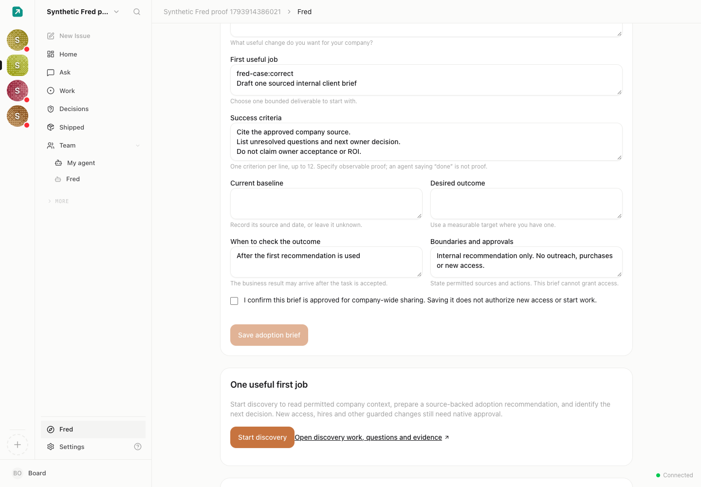
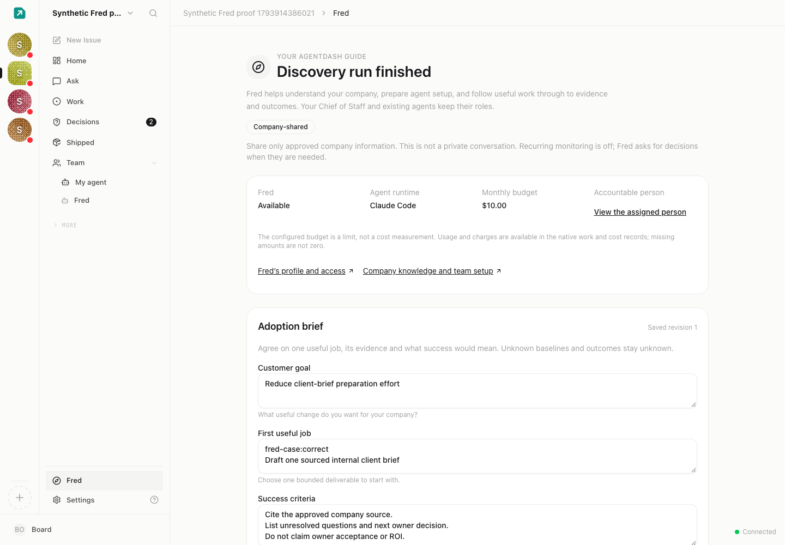

# Fred: local validation and review boundaries

This branch adds the first owner-driven discovery workflow for AgentDash’s built-in FDE guide. It is awaiting review and release. No customer instance, provider account or production system was used for these fixtures. Avatar work and the separate temporary-access proposal are outside this change.

## Owner workflow

Set up a registered company guide with a positive budget and explicit company-sharing consent; save a versioned adoption brief; explicitly Start discovery; answer a native question; inspect the saved report and native evidence. Setup makes no model call. CoS and existing agents retain their identities. The first job produces an adoption recommendation and next owner decision, not an automatically configured specialist team or measured ROI.

Before explicit Start (synthetic UI, saved brief and zero runs):

After native discovery execution (synthetic UI; acceptance and outcome remain separate):

These are November 5 fixture states before/after discovery, not a real customer’s results or a before/after comparison of different product versions. The later request-retry correction is covered by separate regression tests below.

## Frozen runtime challenge

Run `scripts/fred-runtime.mjs` as described in `tests/e2e/fixtures/fred/README.md`. This opens the actual source UI and uses the registered claude_local adapter with a contained deterministic executable, never a real provider/client/model. The native control plane authenticates actual task tools, memory, questions, documents and approval refusals.

| Fixture | Native observation | Evidence-based result |
| --- | --- | --- |
| Correct report | Two native runs, persistent memory round-trip, scripted owner UI answer, exact saved revision | Automated proof pass; human acceptance unknown |
| Convincing false completion | Task and run done; saved report bytes wrong | Automated proof fail |
| Approval block | Pending native approval; self-approval403; no downstream action | blocked_on_person; incomplete |
| Missing work | Assigned todo; zero runs/documents | not_started; no acceptance |
| Unsupported proof | Report exists but required proof cannot be verified | unknown; never pass |

Frozen rubric `fred-runtime/1`, SHA256 `c7b0106d1587f74bc816fadb9c454a53179c1b6863edf38b3ea4e16f4dd92968`. The retained November 5 native replay agreed through sequence552, hash `cee0623a57fb6b3286aaafe7abaef82b6306dbc8a17c9474f2eef13bb7c1db9e`. Every run was refused403 attempting to create its own evaluation snapshot. Raw evidence is retained with the local orchestration handoff, rather than exporting private configurations or credentials into this repository.

Observed automated acceptance was1yes/1no/1unknown of3 delivered items; human acceptance/use/outcomes were0yes/3unknown. Exact document bytes are not proof of business-semantic quality. Measured scripted elapsed63.114s with concurrent local checks,16UIactions/23overlappingAPI mutations; this is not a performance benchmark or measured human correction effort. Provider calls0; scripted usage0 is not a real provider bill.

## Regression and recovery

`server/src/__tests__/fred-brief-proof.test.ts` is the frozen six-case `fred-brief-proof/1` suite. A deliberately injected production guard that trusted an approval label without inspecting the document failed3cases. Exact restoration passed6cases with the unchanged test SHA256 `96aca646ea8b2640d378bf6484b7f58d495b5aef470556763daa162422028814`. Failed source/logs and before/after hashes remain retained. No rubric was weakened.

A later independent review reproduced a recovery bug: the intent timestamp committed before native submission, but a failed submission left no retry control. The UI now offers **Retry discovery request** only before any native run has been recorded. It submits the same registration and expected revision; the existing durable request key prevents duplicate jobs/runs. Reloading never automatically retries. Both service and UI regressions failed against the original implementation and pass after the fix. Changing the owner brief after the saved request blocks retry against the old pinned task; the operator must inspect the native work instead of silently repinning criteria. Once execution exists, recovery remains in that native thread.

## Checks and limits

The initial bounded local implementation passed the full UI suite3251, shared696, targeted server170, registration/migration6, types, UI build and native five-case fixture. The retry delta adds two service cases and two UI cases: current focused results18Fred+6proof and16UI, with the full CI pipeline authoritative for the final PR head. Final CI status belongs to the PR checks; this document does not assert it in advance.

Independent code and architecture review are separate AI reviews, not genuine human labels or customer acceptance. Actual Claude/Codex/Hermes clients/models, live business APIs, human grader calibration/correction labor, a real customer using the first recommendation and delayed ROI remain pending. No general private-agent information isolation or arbitrary-code host sandbox is claimed.

## Migration and rollout

Migration 0162 adds the company-scoped Fred registration and unique identities; use the normal migration-before-serving-code procedure. (It shipped as 0158 in the withdrawn v2026.1109.0; the re-land renumbered it after 0158–0161 landed on main, and every statement is a no-op when the identical table from that withdrawn 0158 already exists.) A protected same-company registration excludes one guide from worker headcount, with native budget/usage/quota enforcement intact. No production entitlement has changed. Old code can retain the additive data but counts Fred as an ordinary agent; rehearse capacity consequences before any rollback. Missing/reassigned/deleted bindings fail closed and require owner/admin inspection; setup never silently replaces identity or interrupts active work.

Merge, stable release and exact-instance upgrades remain separate approvals. Do not infer them from this PR, test counts, screenshots or an AI review. Timers remain off. The deferred temporary-access feature is not included.
